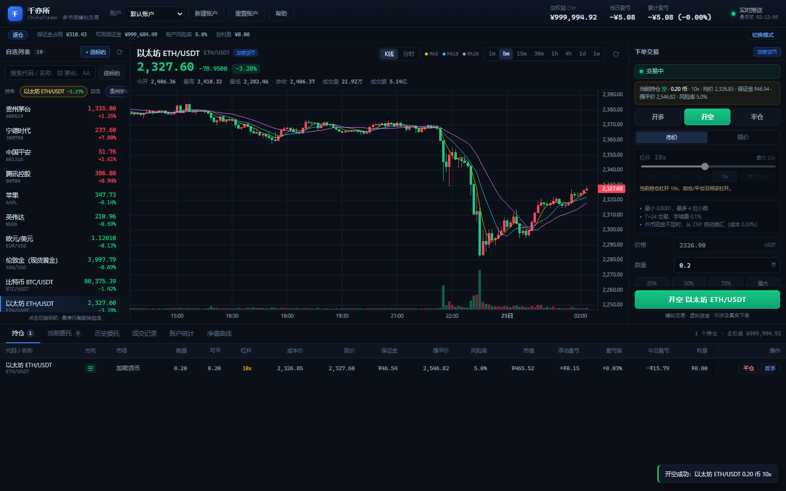

# 千亦所 ChimaTrader · 本地多市场模拟交易台

[](LICENSE)
[](https://nodejs.org/)
[](https://github.com/rinttt233/chima-trader/releases)
[](https://github.com/rinttt233/chima-trader)

> 千亦所 ChimaTrader（简称 **ChimaTrader**）— 开源、可离线运行的模拟交易终端。零第三方依赖，数据全部来自公开只读行情接口。
>
> **下载即用**：前往 [Releases](https://github.com/rinttt233/chima-trader/releases) 下载 `chima-trader-v1.0.0.zip`，解压后双击 `start.cmd`（需 Node.js ≥ 20）。

一个跑在自己电脑上的模拟交易平台：**行情接真实市场，资金完全是虚拟的**。不涉及任何真实货币交易，也不接入任何券商/交易所的下单通道（只读公开行情）。

覆盖五个市场：A 股、港股、美股、外汇（含伦敦金/银）、加密货币。



> 更多界面：新手引导 [docs/onboarding.png](docs/onboarding.png) ｜ 全市场标的库 [docs/universe.png](docs/universe.png) ｜ 杠杆与风险预警 [docs/risk.png](docs/risk.png)

```
双击 start.cmd            # Windows 一键启动（自动打开浏览器）
node server.mjs           # 或者手动启动，浏览器打开 http://127.0.0.1:8787
node selfcheck.mjs        # 全链路自检（离线单测 + 联网行情 + HTTP 冒烟）
```

---

## 一分钟上手

1. 安装 Node.js ≥ 20（开发环境为 24），`node -v` 能看到版本号即可。无需 npm install，零第三方依赖。
2. 双击 `start.cmd`（或在本目录执行 `node server.mjs`），看到 `千亦所 ChimaTrader 已启动` 即成功。
3. 浏览器打开 `http://127.0.0.1:8787`。
4. 首次启动自动创建「默认账户」，初始资金 100 万 CNY（可新建账户或重置）。
5. 左侧自选点选标的 → 中间看图 → 右下填单 → 下方标签页看持仓、委托、成交、统计、净值。

> 加密行情需要本机代理（见「数据源」）。代理没开时其余四个市场照常可用，只影响加密报价与部分美股 K 线。

---

## 功能

**上手引导（小白友好）**
- 首次打开自动 4 步全屏引导：模拟盘是什么 → 左边选标的 / 中间看图 / 右边下单 → 市价 vs 限价、整手与 T+1 → 下方标签页怎么用
- 顶栏「帮助」随时重看：6 步上手 + 术语速查（市价/限价/T+1/涨跌停/整手/手续费/自动换汇/休市）
- 新手提示开关（默认开）：下单面板直接告诉你当前市场的规则；空持仓/空委托时有「去自选挑一只标的」行动按钮
- 休市状态条：明确显示「交易中 / 午间休市 / 未开盘 / 已收盘 / 周末休市 / 数据源异常」，并解释为什么按钮是灰的、能不能提前挂单

**行情**
- **实时推送**（SSE）：加密 0.5 秒、外汇 1 秒、股票 2 秒一档，页头显示「实时推送 / 轮询 / 离线」三态，断线自动降级轮询并后台重连
- 价格变动 200ms 红绿闪烁；K 线最后一根、分时最后一点、MA 随推送实时更新
- 五市场实时报价、涨跌幅、五档盘口（A股/港股；美股一档）
- K 线：A股 1m/5m/15m/30m/60m/日/周/月；港股分钟线由分时聚合；美股/外汇日/周/月（有代理时补分钟线）；加密 1m~1w
- 成交量、MA5/MA10/MA20、十字光标 OHLC 浮层
- **标的库**：一键打开 A股/港股/美股/外汇/加密全市场列表（每市场约 100 条，按成交额或涨跌幅排序），带搜索、`+自选`、点击切换
- **智能候选**：自选列表顶部常驻 chips，顺序为「持有 → 自选 → 最近查看 → 可交易（当前开市且买得起）」，一点即切
- 自选列表、全市场搜索（中文名 / 代码 / 拼音）

**交易**
- 市价单 / 限价单，买 / 卖；挂单每 2 秒用真实行情撮合
- **杠杆交易**：加密最高 20x、外汇最高 100x、美股/港股最高 4x（A股 1x），支持**做空**
- **保证金模式**：逐仓 / 全仓可切换（无持仓无挂单时）；强平价、风险率、保证金占用实时计算，风险率过高自动强平
- **附带操作**：一键平仓、反手、止盈止损（TP/SL）、未成交限价单改价、风险度 >80% 预警
- A 股：100 股整数倍、T+1、涨跌停价校验、涨停买入/跌停卖出按无流动性拒绝
- 港股按每手股数、美股按整股、外汇按货币单位（2 位小数）、加密按交易所步长
- 手续费贴近真实：佣金 / 印花税 / 过户费 / SEC 费 / 点差 / 滑点；杠杆仓位另计**借币利息**（按小时累计）与**强平费**，下单面板可展开费用构成，全部可在 `config.json` 调整
- **多币种现金账户**（CNY/HKD/USD/USDT）+ **下单自动换汇**：人民币账户可直接买港美/外汇/加密，按实时汇率从 CNY 换入差额，换汇成本 0.3%
- 节假日/休市保护：行情过期（>10 分钟未更新）时拒绝市价成交、暂停挂单撮合，不会用旧价成交

**账户**
- 多账户、自定义初始资金、随时重置、成交记录导出 CSV（Excel 直接打开）
- 持仓（成本 / 浮盈 / 今日盈亏 / 可卖数量）、当前委托（可撤单）、历史委托（状态筛选）、成交记录
- 账户统计：胜率、盈亏比、最大回撤、夏普、总手续费、分市场 / 分标的统计
- 净值曲线（60 秒一次快照，可切 1日/1周/1月/全部）
- **时间刻度记忆**：每个市场记住你上次选的 K 线周期，刷新页面/重开浏览器后自动恢复；图表模式、当前标的、账户、底部标签页同样会记住

---

## 数据源

| 市场 | 数据源 | 说明 |
|---|---|---|
| A 股 | 腾讯行情 `qt.gtimg.cn` / `ifzq.gtimg.cn` | 直连，实时报价 + 五档 + 分钟/日/周/月线 |
| 港股 | 腾讯行情 | 直连；分钟线由最近一个交易日的分时数据聚合 |
| 美股 | 腾讯行情（报价）+ Yahoo（K 线） | 报价直连；日/周/月与分钟 K 线走 Yahoo，需要代理 |
| 外汇 | 腾讯行情 `wh*` | 直连，12 个货币对；EURJPY/GBPJPY 报价停更会在健康状态里标注 |
| 伦敦金/银 | 腾讯报价 `hf_XAU`/`hf_XAG` + 新浪现货日线 | 日线国内直连；分钟线走 Yahoo 期货，与现货有约 0.2% 基差 |
| 加密 | Binance 公共行情（CoinGecko 兜底） | **需要本机代理** |

所有行情都来自公开只读接口，不需要注册、不需要 API Key。采集失败自动降级为缓存并标记过期，页面不会崩。

「标的库」的全市场列表来源：A股/港股 = 新浪排行接口（国内直连，分页拉全市场），美股 = Nasdaq screener（Yahoo 兜底），加密 = Binance 全量 700+ 个 USDT 交易对，外汇 = 12 个货币对 + 金银。任何源不可用时回退到内置精选列表并在列表顶部说明原因。

### 代理设置

加密行情、美股 K 线需要访问境外网络。程序不会自己起代理，而是复用 `config.json` 里配置的本地 HTTP 代理：

```json
"proxy": { "enabled": true, "host": "127.0.0.1", "port": 65532,
           "hosts": ["api.binance.com", "api.coingecko.com", "query1.finance.yahoo.com"] }
```

默认值取自开发机的系统代理（127.0.0.1:65532）。你的代理端口不同就改成自己的；不需要境外数据源可以把 `enabled` 设为 `false`（此时加密行情不可用，A股/港股/外汇不受影响）。

页头右上角的「数据源正常」点进去可以看到每个源的实时健康状态（含延迟与中文原因）。

---

## 交易规则

| 市场 | 交易时段（北京时间） | 最小单位 | T+1 | 涨跌停 | 费用 |
|---|---|---|---|---|---|
| A 股 | 09:30–11:30 / 13:00–15:00 | 100 股 | 是 | ±10%（创业板/科创板 ±20%，ST ±5%，以行情给出的涨跌停价为准） | 佣金 0.025%（最低 5 元）+ 卖出印花税 0.05% + 过户费 0.001% |
| 港股 | 09:30–12:00 / 13:00–16:00 | 每手（常见 100 股） | 否 | 无 | 佣金 0.025%（最低 100 HKD）+ 印花税 0.1% + 交易/结算费 |
| 美股 | 21:30–04:00（夏令时） | 1 股 | 否 | 无 | 0.005 美元/股（最低 1 美元）+ 卖出 SEC 费 |
| 外汇 | 周一 05:00 – 周六 05:00（每日 05:00–06:00 维护） | 1 单位（2 位小数） | 否 | 无 | 点差 1.5bp（含在价里）+ 滑点 2bp |
| 加密 | 7×24 | 交易所步长（默认 0.0001） | 否 | 无 | 0.1%（双向）+ 滑点 3bp |

### 杠杆与保证金

| 市场 | 最大杠杆 | 可做空 | 维持保证金率 | 借币年化 | 强平费 |
|---|---:|---|---:|---:|---:|
| A 股 | 1x | 否 | — | — | — |
| 港股 | 4x | 是 | 12.5% | 6% | 0.2% |
| 美股 | 4x | 是 | 12.5% | 6% | 0.2% |
| 外汇 | 100x | 是 | 0.5% | 3% | 0 |
| 加密 | 20x | 是 | 0.5% | 8% | 0.5% |

- 开仓占用保证金 = 名义价值 / 杠杆；杠杆仓位权益 = 保证金 + 浮动盈亏 − 已计利息。
- **逐仓**：每个仓位独立计算强平价，跌破维持保证金单独强平；**全仓**：全账户共享保证金，账户权益低于总维持保证金时按亏损从大到小依次强平。
- 利息按小时线性累计（`年化 / 8760`），平仓时从所得中扣除。
- 强平价/风险率可在持仓表直接看到；风险率 >80% 高亮提醒。

- 成交价基于真实盘口：市价买 = 卖一价 + 滑点，市价卖 = 买一价 − 滑点。
- 限价单挂单后每 2 秒撮合一次；休市期间挂单保留，下一个交易时段参与撮合。
- 权益折算汇率取实时外汇报价（USD/CNY、HKD/CNY，USDT 近似 USD）。
- 所有数字都能改：`config.json` 的 `fees`、`slippageBps`、`lots`、`sessions`、`autoConvert`、`fxConvertSpread`。

---

## 配置

| 键 | 作用 |
|---|---|
| `server.host` / `server.port` | 监听地址与端口（默认 127.0.0.1:8787，也可用 `PORT` 环境变量） |
| `dataDir` | 数据目录（默认 `data/`，可用 `CHIMATRADER_DATA_DIR` 覆盖） |
| `proxy` | 境外数据源代理 |
| `defaults` | 初始资金、基础币种、默认自选 |
| `refresh` | 行情刷新 / 撮合 / 净值快照间隔（毫秒） |
| `fees` / `slippageBps` / `lots` / `sessions` | 交易规则与成本 |
| `leverage` | 各市场最大杠杆（cn 1 / hk 4 / us 4 / fx 100 / crypto 20） |
| `margin` | 维持保证金率、借币年化利率、强平费率 |
| `autoConvert` / `fxConvertSpread` | 下单自动换汇开关与成本 |

账户数据保存在 `data/state.json`（原子写入）。想彻底重来：停服 → 删除该文件 → 重启。

---

## 目录结构

```
chima-trader/
  start.cmd             Windows 一键启动
  server.mjs            HTTP 服务：REST API、撮合循环、静态托管
  config.json           端口/代理/费率/时段/自选等配置
  selfcheck.mjs         全链路自检
  docs/screenshot.png   界面截图
  NOTES.md              开发笔记：数据源坑位与可复用结论
  lib/
    net.mjs             直连 + 本地代理隧道、重试、TTL 缓存、GBK 解码
    symbols.mjs         符号解析（唯一入口）、市场元数据、港股手数表
    marketdata.mjs      统一行情门面（报价/K线/搜索/标的库/汇率/健康）
    sources/            腾讯 / Binance / CoinGecko / Yahoo / 新浪 适配器
    sources/universe.mjs        全市场标的列表（新浪/Nasdaq/Binance + 兜底链）
    sources/fallback-universe.mjs  各市场内置精选兜底列表
    engine.mjs          撮合引擎（T+1、涨跌停、手续费、滑点、限价撮合、自动换汇）
    store.mjs           JSON 持久化（原子写 + 损坏恢复）
    stats.mjs           胜率/盈亏比/回撤/夏普/净值序列
  public/               前端 SPA（深色中文界面，lightweight-charts K 线）
  test/                 engine 单测（63 例）、行情联网检查（约 63 项）、HTTP 冒烟（32 项）
  docs/                 界面截图
  data/state.json       运行时账户数据（首次启动生成）
```

---

## 自检

```
node selfcheck.mjs              # 汇总四层，全绿才退出 0
node selfcheck.mjs --json       # 机器可读结果
node test/engine.test.mjs       # 只跑撮合与保证金规则单测（离线，63 例）
node test/marketdata.check.mjs  # 只跑行情源联网检查（约 63 项，含标的库）
node test/http.smoke.mjs        # 只跑端到端 HTTP 冒烟（32 项，含 SSE、杠杆开仓→平仓、下单→持仓→撤单）
```

判据：文件齐备、引擎单测、HTTP 冒烟为必须；行情联网检查中境外源不可达只算警告（代理没开时属预期）。

### 主要接口

- `GET /api/stream`：SSE 实时行情推送（`quotes` / `heartbeat` 事件）
- `GET /api/quotes`、`/api/kline`、`/api/search`、`/api/universe`、`/api/markets`、`/api/health`
- `GET/POST /api/accounts`、`/api/accounts/:id`、`/api/accounts/:id/orders`、`/trades`、`/stats`、`/equity`、`/export/trades.csv`
- 完整契约见 [CONTRACTS.md](CONTRACTS.md)

---

## 界面演示数据（不启动后端也能看）

URL 加 `?mock=1` 使用内置假数据（含每秒推送的模拟行情，可离线体验实时 UI）；`?mock=1&seed=1` 会预置一个带多市场持仓、挂单、成交、统计和净值曲线的演示账户。

---

## 已知限制

- 模拟盘没有真实撮合队列：按盘口/现价 + 滑点成交。涨停买不到、跌停卖不出已按规则拒绝，但无法模拟排队深度。
- 杠杆是简化模型：没有资金费率/永续合约/逐档强平排队，利息按小时线性累计；强平按当前报价一次性市价成交，极端跳空时可能出现穿仓（权益为负），模拟盘不做追缴。
- A 股不支持融资融券（恒 1x、不可做空），股票杠杆只覆盖港美股；不提供期权/期货。
- 没有节假日日历，休市判断依赖「行情是否过期」+ 周末时段；A 股长假期间会拒绝成交，但不会区分具体节日名称。
- 港股手数表覆盖约 40 只常见股票（其余按 100 股/手，且优先使用行情返回的每手股数）。
- 港股分钟线只有最近一个交易日的分时；美股/外汇分钟线依赖 Yahoo；金银分钟线是期货价（与现货有约 0.2% 基差）。
- 加密日线以 UTC 00:00 为边界（显示为北京 08:00），与 A 股/外汇日线的北京时间 00:00 边界不同。
- 标的库每个市场默认取约 100 条（按成交额/涨跌幅）而不是全市场数万条，其余标的用搜索查找；美股成交额是「价格 × 成交量」的估算值。
- 实时推送通过浏览器 EventSource 实现；极端情况下（浏览器/网络代理拦截 SSE）会自动降级为 2 秒轮询，功能不受影响。
- 净值历史从首次运行开始积累，不回溯；撮合成交的部分状态按 300ms 合并落盘，强制结束进程最多丢失最近几百毫秒的行情标记（成交与委托本身是同步保存的）。

---

## 开源与许可

- 本项目代码以 **MIT** 许可发布，见 [LICENSE](LICENSE)；可自由使用、修改、再分发（保留版权声明）。
- 内置图表为 TradingView Lightweight Charts™（Apache-2.0），原始 license 头保留在文件内；完整第三方声明见 [THIRD_PARTY_NOTICES.md](THIRD_PARTY_NOTICES.md)。
- 行情数据版权归各数据源所有，本项目仅用于学习与模拟练习。

## 声明

本项目仅用于学习与模拟练习：所有资金、成交、盈亏均为虚拟，不构成任何投资建议，不连接任何真实交易通道。
